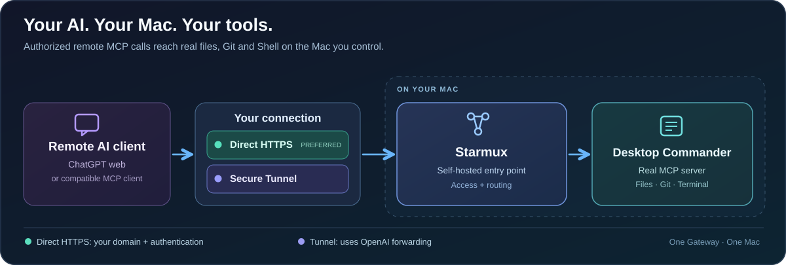

<div align="center">

# Starmux

### Your computer. Your tools. Connected to your AI.

Connect remote AI clients to files, terminals and development tools on your own computer. **Keep your development environment. Choose what AI can do. Start, stop and revoke access on your terms.**

**Self-hosted MCP · Native macOS menu bar App · Cross-platform CLI preview · MIT**

[Quick Start](#quick-start) · [Connect a client](docs/REMOTE_SETUP.md) · [Documentation](docs/README.md)

</div>

## Your AI client here. Your tools there.

Your repositories, runtimes and development tools already live on your computer. Starmux lets your AI client work with that environment through a self-hosted MCP connection: inspect a project in read-only mode, or enable coding to edit files, run tests and use Git.

- **Keep the tools you know.** Work with the files and software already installed on the host.
- **Choose your AI client.** Use a compatible remote MCP client through HTTPS or a protected Tunnel.
- **Stay in control.** Start safely with read-only access. Enable coding deliberately, give clients their own credentials and revoke access when needed.

Install Starmux on the **computer whose files and tools you want to use**. Your AI client can run elsewhere.

## Quick Start

### 1. Install

Requires Node.js **22.12 or newer**.

```bash
npm install -g starmux
```

### 2. Start in your project

```bash
cd /path/to/your/project

# Safe read-only mode (default)
starmux up

# Full coding mode: file edits, Shell and Git
starmux up --code
```

Starmux initializes itself and runs in the background. Coding mode asks for confirmation the first time; `--code` and `--write` are equivalent. Coding tools use your OS account's permissions, with the project as their default working directory.

```text
Starmux · default · running
Workspace  /path/to/your/project
Mode       Read-only
Runtime    background
MCP        http://127.0.0.1:18893/mcp
Dashboard  http://127.0.0.1:18893/access
Logs       starmux logs -f -i "default"
```

### 3. Create an API key (optional)

For clients that support Bearer authentication:

```bash
starmux auth key "My AI Client"
```

This creates a key and enables API-key authentication immediately. Copy the key into your client's private configuration.

## How it connects




```text
AI client
    → HTTPS / protected Tunnel
    → authentication: ingress | API key | OAuth
    → Starmux at 127.0.0.1:<port>/mcp
    → your files and development tools
```

HTTPS or a protected Tunnel carries the connection; authentication determines who can connect; the permission mode controls what tools can do. Start with the route your client supports:


| Client or deployment | Next step |
| --- | --- |
| WorkBuddy or a client accepting Bearer headers | [HTTPS + API key](docs/REMOTE_SETUP.md#2-https--bearer-api-key) |
| ChatGPT with browser login | [OAuth provider and connection setup](docs/OAUTH.md) |
| An existing protected ingress or MCP Tunnel | [Remote connection guide](docs/REMOTE_SETUP.md) |

The guide connects the pieces: DNS, HTTPS/proxy or Tunnel, authentication, and a real client tool call. These network services are configured separately from Starmux.

## Everyday commands

```bash
starmux status
starmux verify          # Local MCP handshake and directory read
starmux doctor          # Environment and configuration checks
starmux dashboard      # Open the local Access console
starmux logs -f
starmux down            # Alias: stop
```

After initialization, `up` reuses your saved workspace. Use `starmux up .` to switch it to your current directory, or pass another path. `--foreground` keeps the process in your terminal.

## A quiet place to keep an eye on things

The native macOS menu bar App puts service health, workspace permissions, connection topology and recent tool activity in one compact panel. Start or stop the selected workspace, open its Access console, and keep the details close without leaving a management window open.

<div align="center">
  
  <p><sub>Native macOS menu bar App · English and Chinese · Development build</sub></p>
</div>

The App and CLI control the same instances. Quitting the App stops only instances it started; CLI background instances keep running. [App build instructions](app/README.md)

## More than one workspace

```bash
starmux up ~/work/repo-a -i work --code
starmux up ~/personal/blog -i blog --read
starmux ls
starmux down -i work

starmux config edit -i blog
starmux config apply -i blog
```

Instance names are your labels. Each instance has its own port, configuration, credentials, policies and logs. [Instances and configuration →](docs/INSTANCES.md)

## AI client compatibility

These are recorded project workflows, including those validated before the Starmux rename. They are not a claim that every client, authentication mode and platform combination has passed the new release.

| Client | Recorded validation |
| --- | --- |
| **ChatGPT web** | Tunnel + OAuth, including coding and session revocation |
| **Codex** | Installed Gateway plugin through protected Tunnel |
| **WorkBuddy** | HTTPS + IPv6 + API-key file reads and writes on macOS |
| **Doubao (豆包)** | Owner-reported successful use; connection details not recorded |
| **Claude App** | Compatibility target; end-to-end validation pending |

[Exact test scope and client setup guides](docs/CLIENTS.md)

## Platform support

| Tool host | Core / CLI | Native App |
| --- | --- | --- |
| **macOS** | Starmux 0.10.0 local and published-package workflow tested | SwiftUI development build |
| **Linux** | Preview; earlier Core tests passed on Ubuntu arm64; new CLI release acceptance pending | Not available |
| **Windows** | Preview implementation; native validation pending | Not available |

[Platform details](docs/PLATFORMS.md) · [Release status](docs/RELEASE_STATUS.md). The macOS App is currently an ad-hoc developer build; a signed, notarized public download is not yet available.

## Where this is going

Starmux began with the [community request for a self-hosted Desktop Commander workbench](https://github.com/wonderwhy-er/DesktopCommanderMCP/issues/714). The first priority is a clear path from a local workspace to a real tool call in your preferred AI client.

The longer-term direction is a gateway for more MCP servers and clients, with programmable middleware. A public Middleware SDK and user-script plugins are not shipped. Contributions to first-user setup, client compatibility and platform testing are welcome.

## Documentation and support

- [Installation](docs/INSTALL.md) and [documentation index](docs/README.md)
- [Authentication](docs/ACCESS_CONTROL.md) and [permission boundaries](docs/SECURITY.md)
- [Migrate from Mac MCP Gateway](docs/MIGRATION.md)
- [Client compatibility](docs/CLIENTS.md), [platform support](docs/PLATFORMS.md), and [release status](docs/RELEASE_STATUS.md)
- [Contributing](CONTRIBUTING.md) and [architecture](docs/ARCHITECTURE.md)

Starmux 0.10.0 is a preview. The CLI supports macOS, Linux and Windows; the native macOS App is available as a development build. See the linked compatibility pages for tested combinations.

## Built with Desktop Commander

Starmux includes a pinned [Desktop Commander](https://github.com/wonderwhy-er/DesktopCommanderMCP) dependency, installed automatically with npm. You do not need to install it separately. Starmux supplies its own self-hosted MCP connection and lifecycle controls.

## License

Starmux original code is [MIT licensed](LICENSE). Desktop Commander retains its own license and notices. This independent project is not endorsed by Desktop Commander or AI client vendors.
