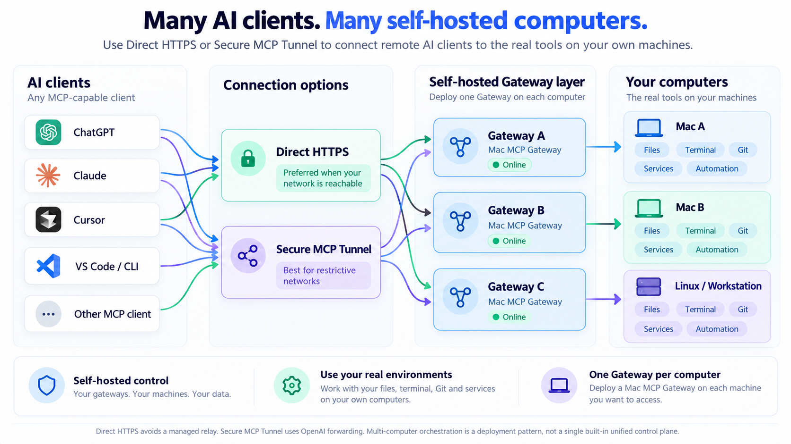
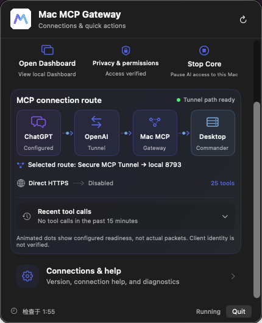

<div align="center">

# Mac MCP Gateway

### Your Mac. Your tools. **Your gateway.**

**Let remote AI agents code on your own Mac — without relying on Desktop Commander's hosted remote relay.**

An independent, self-hosted Gateway for the real [Desktop Commander MCP](https://github.com/wonderwhy-er/DesktopCommanderMCP).

**Configure your own self-hosted MCP backend while retaining Desktop Commander's existing tool capabilities.**

允许配置自托管后端，同时保留现有 Desktop Commander 工具执行能力。

**Our goal: let Mac users self-host a remote AI workbench, clearly choose what AI can access, and easily start, stop, and revoke access.**

让 Mac 用户能够自行部署一个远程 AI 工作台，清楚地决定 AI 可以访问什么，并方便地启动、停止和撤销访问。

**Apple Silicon** · **Menu bar App + CLI** · **MIT licensed**

</div>

> [!NOTE]
> **Community pre-release.** The local App/CLI and a private Tunnel workflow have been tested. Public binaries, independent first-user setup and external identity / authorization / revocation acceptance are still release gates.

## Quick Start

**Run from a Git checkout.** You need Git and Node.js **22.12+** on an Apple Silicon Mac (matching the bundled Desktop Commander dependency). When the clean community repository is published, its URL will be provided here.

```bash
# In your checked-out mac-mcp-gateway directory
npm ci
npm install --global .
mac-mcp-gateway setup
mac-mcp-gateway doctor
mac-mcp-gateway run
```

In another terminal:

```bash
mac-mcp-gateway verify             # Verify real local MCP tools
mac-mcp-gateway status           # Core status + Dashboard
mac-mcp-gateway stop             # Stop the single Core
mac-mcp-gateway run              # Start it from the installed CLI
```

The global CLI installation was checked in an isolated npm prefix. The setup wizard configures a private local profile, normally on port **18893**. It does **not** automatically create a ChatGPT connection. An already-running Gateway session must be stopped before starting another Core.

`mac-mcp-gateway run` displays an English startup panel with **Config source**, **Core program**, **Build version**, and **Listening port**. The build identifier includes a fingerprint of the compiled code. Saved onboarding settings take precedence over legacy settings, and both use the Core shipped with the CLI you invoked. Daily use does not require `node bin/...` or a `--profile` option. Use `run --json` for structured startup diagnostics.

**Prefer a Mac App?** The intended public distribution is a prebuilt Apple Silicon `.zip` on GitHub Releases: extract it, move the App to Applications, launch, choose permissions and connection mode. **No Xcode or separate Node.js for the packaged App.** A properly signed / Gatekeeper-verified public ZIP has **not yet been released**; today's ZIP builds are internal development artifacts.

[Full local setup (English)](docs/INSTALL.md) · [Test TypeScript alongside an existing installation](docs/INSTALL.md#testing-this-typescript-checkout-with-an-existing-installation) · [Connect ChatGPT — HTTPS or Tunnel](docs/CONNECT_CHATGPT.md)

**Testing the full coding workflow?** Configure the trusted developer role explicitly, then start the Gateway:

```bash
mac-mcp-gateway setup --access-role trusted --connection tunnel --approve-trusted-developer
mac-mcp-gateway doctor
mac-mcp-gateway run
```

This is an alternative to the basic interactive `mac-mcp-gateway setup` above, which asks for read/write mode but does not select the trusted native role. `--connection tunnel` only records a connection preference. Existing setup files are protected from replacement; see the installation guide before changing an existing profile.

## Why run your own Gateway?

**Your AI runs in the cloud. Your code, Git repositories, and terminal live on your Mac. Why should someone else control the bridge?**

Desktop Commander already gives AI powerful local tools. Its hosted Remote MCP service makes them accessible from the web. But what if you want to **own and operate that connection yourself?**

**Mac MCP Gateway puts that bridge in your hands.** It lets ChatGPT and other remote MCP clients access the real files, Git, terminal, and development tools on your Mac — through a self-hosted connection you control, without relying on Desktop Commander's hosted relay.

**It's not another coding agent. It's the connection layer that brings remote AI to your own development environment.**



<sub>Illustrative multi-client/multi-computer deployment vision. The current community preview has only been verified with one macOS Gateway; Linux support and unified multi-host management are not shipped.</sub>

### First release: a self-hosted Desktop Commander remote workbench

The first release focuses on people who want Desktop Commander's remote coding capabilities while operating their own Gateway. Desktop Commander remains the execution engine; Mac MCP Gateway provides the self-hosted connection, routing, and native SwiftUI App / TypeScript CLI management experience. The longer-term direction is a general-purpose Gateway for multiple MCP servers and AI clients.

In owner-approved **trusted native mode**, the Gateway forwards the upstream Desktop Commander tool names, input schemas, arguments, and results without replacing them with a reduced read-only tool set. This supports the coding loop: read code, edit files, run commands and tests, inspect results, and iterate. Explicit owner deny rules, Desktop Commander controls, and macOS permissions still apply. The JavaScript version has been used by its maintainer to develop and iterate on the Gateway itself.

**Permission profiles:** choose restricted mode for project-scoped read-only access, or explicitly approve trusted native mode for the upstream coding tools. Both use the same Core. See [security boundaries](docs/SECURITY.md) and the [connection guide](docs/CONNECT_CHATGPT.md) for deployment requirements.

Community interest in this use case is reflected in [DesktopCommanderMCP issue #714](https://github.com/wonderwhy-er/DesktopCommanderMCP/issues/714), which requests a configurable self-hosted backend for the official remote integration. Mac MCP Gateway offers a separate self-hosted MCP connection; it does not implement backend selection inside the official plugin or claim drop-in compatibility with its private hosted service.

### Programmable MCP Middleware — own what happens between AI and tools

**A connection layer you operate can become a policy and automation layer you customize.** Instead of treating the MCP protocol as a black-box pipe, imagine having explicit decision points before and after a tool call.

The direction is **programmable MCP middleware**: intercept requests, evaluate conditional rules, require approval, block risky operations, choose an upstream, validate permitted argument changes, or trigger owner-approved scripts when a tool returns. For example:

```text
Before a tool call:
  if the client requests a protected operation → require approval
  else → forward the tool call to the actual MCP server

After a tool result:
  if a build failed → record the outcome or trigger a local notification
```

**Implementation status:** the Gateway already provides MCP routing, authorization checks and limited auditing. **General-purpose user-defined hooks and script plugins are planned, not yet a shipped feature.** Custom logic must never silently bypass caller authorization or the upstream's execution boundaries.

## How ChatGPT connects

**Local installation is only step one.** After your Gateway is healthy, you still need to make it reachable to ChatGPT and add it as a custom MCP server in the ChatGPT web interface. Choose one of two connection paths:


| Connection | Best for | What you configure |
| --- | --- | --- |
| **1. Direct HTTPS — preferred** | Users with a reachable public IPv4/IPv6 address and domain | Your DNS **A/AAAA** record → HTTPS/TLS reverse proxy on port **443** → real caller authentication → Gateway |
| **2. Secure MCP Tunnel** | CGNAT, restricted firewalls and difficult inbound networking | Your **own** OpenAI Platform Tunnel, local `tunnel-client`, ChatGPT workspace permissions |

**In ChatGPT web:** open **Plugins → + → Add custom MCP server**, enter a name, then either paste your public `https://your-domain.example/mcp` URL or choose **Tunnel** and select your own Tunnel ID. Configure authentication and confirm access by making an actual permitted tool call.

**DNS alone is not enough.** Direct HTTPS also requires public reachability, a valid certificate, an authenticated reverse proxy and a protected MCP endpoint; none of those are created just by pointing a domain at your Mac. Tunnel setup instead follows OpenAI's official workflow and does not require inbound router ports.

**[Connect ChatGPT — step-by-step HTTPS and Tunnel instructions →](docs/CONNECT_CHATGPT.md)**

> **Current release gate:** Private Tunnel coding workflows have been exercised, but independent end-to-end identity, permitted-operation, denied-operation and revocation acceptance for **both** connection methods remains incomplete. Expected permissions depend on the selected profile; trusted native mode is not limited to reads. A healthy local Core is not proof of an authenticated remote session.

## One Gateway. App or CLI.

Both interfaces control the **same** local Core. Start, inspect or stop it from the menu bar, or keep everything in the terminal.

<div align="center">
  
  <p><sub>Actual Mac menu bar App · English and Chinese supported · Route readiness is not client identity verification.</sub></p>
</div>

The local Dashboard URL is printed by `mac-mcp-gateway status`. The owner's development instance uses `http://127.0.0.1:8793/dashboard`; a new source setup normally uses another port.

## Security is the product, not an afterthought

- **Restricted read-only:** project-scoped reads, no arbitrary Shell or write actions.
- **Trusted developer:** deliberate owner approval for native Desktop Commander tools. The tested process sandbox allows direct writes within Home, denies writes outside Home, and still follows macOS permissions.
- **Identity first:** a TLS certificate or a Tunnel connection alone does not authenticate and authorize every calling AI user. Never expose the raw local port directly to the internet.
- **Know the limit:** the process sandbox doesn't automatically contain unrelated apps, additional upstreams or IPC services. AI prompts and script execution can still carry risk.

[Security and trust boundaries](docs/SECURITY.md) · [Architecture](docs/ARCHITECTURE.md)

## Release status and contributions

This repository remains **pre-release development source**. A clean public repository, developer-signed distribution, independent clean-Mac installation, remote security verification and third-party license notice review are still pending. The current private owner's Tunnel configuration and Git history are **not community defaults** and must not be distributed.

[Community release checklist](docs/RELEASE_STATUS.md) · [Contributing](CONTRIBUTING.md) · [Report security issues](SECURITY.md)

## License

Mac MCP Gateway original code is released under the **[MIT License](LICENSE)**, copyright © 2026 Mac MCP Gateway contributors.

Desktop Commander is a **separate MIT-licensed upstream project**; preserve its original notices when redistributing bundled binaries. Mac MCP Gateway is independent of, and not endorsed by, Desktop Commander or OpenAI.

## Core development

Gateway Core and CLI use strict TypeScript in a single ESM package; the macOS App remains native SwiftUI. Run `npm ci` to install and build, `npm run typecheck` for type checking, and `npm test` for compiled contract and integration tests. Source changes require `npm run build`. npm tarballs and App bundles include compiled JavaScript, so runtime users do not need a TypeScript compiler or loader. Existing `.mjs` CLI/helper entrypoints and configuration formats remain supported.

See [architecture and internal middleware](docs/ARCHITECTURE.md) and [contributor validation](CONTRIBUTING.md). Internal hooks do not yet constitute a public Middleware SDK or a user-script plugin system.
